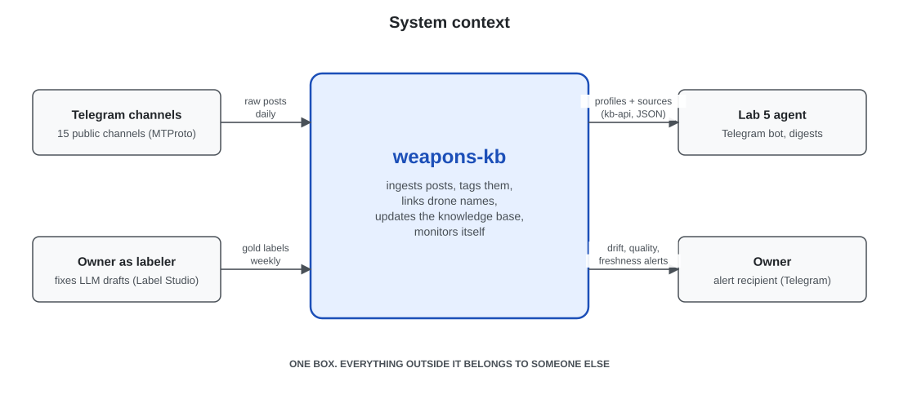
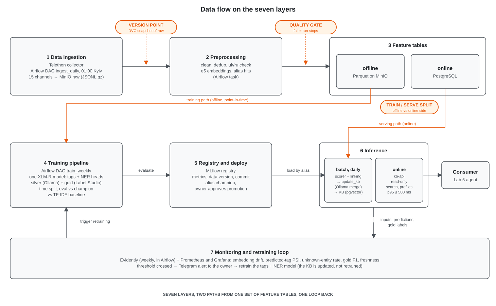
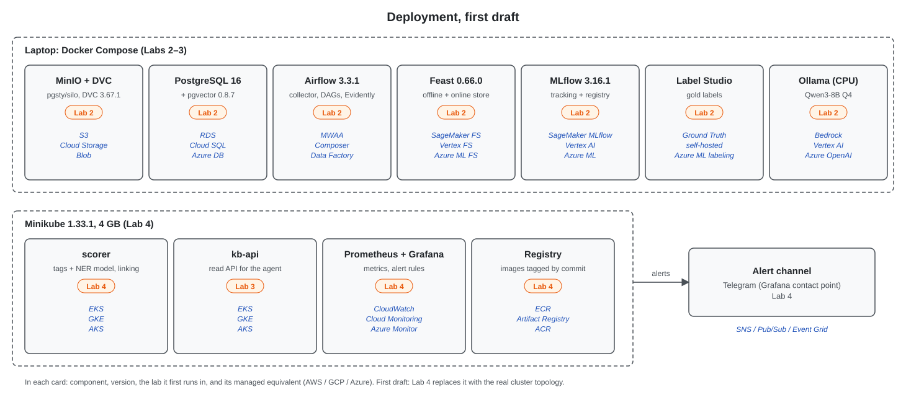

## 1 Overview

Information about drones (UAVs) used in the Russia-Ukraine war is spread across dozens of public Telegram channels that repost, rename and contradict each other. THe miltech Knowledge Base will collect new posts from a fixed list of Ukrainian and Russian channels once a day, uses one trained model with two heads to decide which posts are about drones, which drone types they belong to and which drone systems they name, and links every mention to one profile per drone system. A local LLM keeps each profile up to date and a Telegram bot answers questions related to these profiles, citing the posts it used. The desired outcome is a knowledge base that is never more than one day behind the channels and whose every fact can be traced to a post.

## 2 Motivation

Primary consumers is specified defence tech analytics which will get the infromation through the Telegram bot. In Lab 5 an agent is created for delivering the news from the knowledge base and creating digests from the newest findings. 
About 300 new posts arrive per day (Assumption: 15 channels × 20 posts). However a really small amount of posts contain new info about drones. The KB is refreshed daily, while the bot will be able to be queried at any time.
The input never stops, as new drones are created every other day, therefore one notebook will not be enough.
False negative of the classifier: a drone post never reaches the KB, so a profile misses a fact. S
False positive: a non-drone post reaches the KB, waste of resource and garbage in KB. Caused by irrelevant source. Visible in the profile, cheap to correct.
Wrong entity link: a fact lands in the wrong profile. Most harmful, because it corrupts the KB. Will be mitigated by the alias list and the confidence thr.
Hallucinated fact: every fact must carry a post id and a quoted span, so it can be fact checked

## 3 Success metrics

Labs 1–4 build and run the knowledge base (KB). The Telegram bot and digests are the Lab 5 agent and are not
measured here.

| Layer | Metric | Target | Type | How it is measured |
|---|---|---|---|---|
| Business | KB coverage: drone systems mentioned ≥ 3 times in a week that have a profile | ≥ 90 % (Assumption) | optimizing | SQL over the predictions log in `monitor_weekly` |
| Business | Fact precision: facts in a weekly sample of 20 that the owner confirms against the source post | ≥ 90 % (Assumption) | satisficing | `monitor_weekly` sends 20 random new facts to Label Studio; the owner marks yes/no |
| Model | Tagging head macro-F1 over the 7 tags | ≥ 0.70 | optimizing | gold test set, logged to MLflow after every training run |
| Model | Drone-related recall (a drone post is not missed) | ≥ 0.90 | satisficing | gold test set, MLflow |
| Model | Drone-related precision | ≥ 0.70 | satisficing | gold test set, MLflow |
| Model | NER entity-level F1 on drone names (exact span) | ≥ 0.70 | satisficing | gold spans from Label Studio, `seqeval`, MLflow |
| Model | Entity linking accuracy@1 (span linked to the right profile) | ≥ 0.90 | satisficing | gold spans with the correct profile set by the owner |
| Model | LLM merge faithfulness: facts whose quoted span is found in the post | ≥ 97 % | satisficing | substring check in code on every merge; rejected facts logged |
| Model | Input drift: e5 embeddings of the week vs the training window | no drift detected | satisficing | Evidently embedding drift, weekly in `monitor_weekly` (see 6.6) |
| System | Freshness: a post from day D is in the KB by 06:00 Kyiv on D+1 | ≥ 95 % of days | satisficing | newest post date in the KB at 06:00, Prometheus |
| System | Daily DAG success rate | ≥ 95 % over 30 days | satisficing | Airflow run statuses |

All model targets are assumptions until the first baseline run in Lab 2.

## 4 Requirements and constraints

### Functional

| # | Requirement | Caller |
|---|---|---|
| F1 | Collect new posts daily; backfill from 2025-01-01 | Airflow `ingest_daily` |
| F2 | Clean, deduplicate, validate; a bad batch stops the run | Airflow |
| F3 | Classify each post: drone-related yes/no + tags `fpv, recon, bomber, middle_strike, deep_strike, interceptor, reactive` | Airflow → `scorer /score` |
| F4 | Extract drone names (NER) and link each to a profile via the alias list and embedding search | `scorer /score` |
| F5 | Update the KB: existing profile → LLM adds facts, flags contradictions, attaches post link; no profile → candidate profile | Airflow `update_kb` |
| F6 | Read API over the KB (search, profile, posts by date/tag) for the Lab 5 agent | agent → `kb-api` |
| F7 | Weekly drift and anomaly report with an alert to the owner | Airflow `monitor_weekly` |

### Non-functional

| Category | Requirement |
|---|---|
| Freshness | Daily batch; KB at most one day behind. |
| Latency and throughput | ~300 posts/day. Scoring ≥ 300 posts/min on CPU. KB merge ≤ 10 min/night (≤ 5 drones with new facts per night). `kb-api` p95 ≤ 500 ms (Assumption). |
| Availability and fallback | Batch system on one PC, no uptime promise (Assumption). If the registered model cannot load, scoring falls back to the alias rules and marks rows `model=baseline`. If the LLM is down, merges wait for the next night. |
| Reproducibility | Every run reproducible from Git commit + DVC data version + MLflow run id; environment pinned by `uv.lock`. |
| Adaptability | New data via the daily DAG; new models via MLflow alias `champion`; new channels via `configs/channels.yaml`; new drones via the alias list and candidate profiles. |
| Observability without ground truth | Gold labels arrive ~2 weeks late. Until then: embedding drift, predicted-tag distribution, unknown-entity rate. |
| Cost and resource ceilings | One Windows PC (Docker Desktop on WSL2) with 16 GB RAM and a GTX 1660 Super (6 GB VRAM) runs the whole stack; a laptop is used for development only. Minikube 4 GB. LLM ≤ 8B quantized, Qwen3-4B Q4 by default so it fits fully on the GPU. |

Conflict: **freshness vs cost**. Hourly runs would keep the single 6 GB GPU busy with LLM calls all day; cost wins, the KB is daily.

**Niche:** drones (UAVs) only, narrowed from all weapons on 2026-10-22 to get denser data and sharper profiles.
Tag `reactive` marks jet-powered drones and can co-occur with a range tag; middle vs deep strike boundary is 100 km.
**In scope:** text of public posts from the channels in 5.2 (Ukrainian or Russian language), one model (tags + NER),
entity linking, LLM-maintained profiles, read API, drift monitoring, retraining.
**Out of scope until Lab 5:** the Telegram bot, question answering, digests.
**Out of scope:** weapons that are not drones, naval drones and ground robots (no tag for now), media, locations and unit positions, "fake / true" verdicts, private channels and comments, retraining the KB itself.

## 5 Methodology

### 5.1 Problem statement

One **multi-task model**: multi-label **text classification** (drone-related, 7 tags) plus **NER** for drone
names, as two heads on one encoder. Drone characteristics are extracted by the LLM
during the KB merge, not by NER. This is followed by
alias/embedding entity linking. The LLM merges facts into profiles; it is evaluated in Lab 3.

A profile holds: name and aliases, type (tag), country of origin, estimated unit price, estimated quantity
(produced or delivered), and technical characteristics as free key-value pairs. Price and quantity are
estimates and always carry their source post.

### 5.2 Data

**Sources.** 15 public channels via the Telegram MTProto API (Telethon, separate user account); the list is
kept in `configs/channels.yaml` and starts with
[UAVDEV](https://t.me/UAVDEV), [serhii_flash](https://t.me/serhii_flash),
[ukr_informant](https://t.me/ukr_informant), [in_factum](https://t.me/in_factum),
[milinua](https://t.me/milinua); the other 10 are added before Lab 2. Fields: channel, message id, date, text, views, forwards, forward source,
hashtags, edit date. No media.

**Arrival.** One backfill from 2025-01-01 (≈ 100 k posts, Assumption), then a daily batch; the last 3 days
are re-read to catch edits.

**Labels.**

| Label | Source | Delay | Use |
|---|---|---|---|
| Hints | hashtags + alias rules | immediate | fallback rules, features |
| Silver | local LLM on ~5 000 posts; a post with invalid or empty output is retried once, then left out of training | same night | training |
| Gold | the LLM pre-labels ~500 posts, the owner corrects them in Label Studio; then ~50/week | ~2 weeks | test, monitoring |

**Training vs serving.** Training sees full history, all labels and point-in-time channel stats. Serving sees onlythe new post and online features; no labels.

**Checklist.**
- *Time axis:* every post has a timestamp; Lab 2 ingests the next month as a real batch.
- *Holdout:* ~21 months; train ≤ 2026-07, validation 2026-08, test 2026-09 (gold).
- *Label delay:* silver same night, gold ~2 weeks.
- *Text corpus:* the posts themselves; the Lab 3 retrieval corpus is the KB (profiles + linked posts).

**Formats.** Raw: JSONL.gz in MinIO. Clean and features: Parquet. KB and predictions: PostgreSQL.

### 5.3 Techniques

**Baselines:**
- *Metric baseline:* TF-IDF (word and character n-grams) + logistic regression, one-vs-rest, trained on the
  same silver labels; NER = exact match against the alias list (≈ 150 drone names and slang, YAML in Git).
  The candidate must beat it on the gold test set.
- *Fallback:* alias rules (drone-related if any alias matches, tags from the matched aliases); used in
  serving only when the registered model cannot load.
- *One-off reference (Lab 2):* zero-shot Qwen3-4B on the ~500 gold posts, to show what a trained model adds.

**Candidate:**
- One model: `xlm-roberta-base` encoder with two heads trained jointly: a tagging head (pooled text + tabular
  features → drone-related + 7 tags) and an NER head (token classification, one `DRONE` entity).
- `multilingual-e5-base` embeddings are frozen (not trained) and used for profile search, linking and drift.
- Linking: alias match, else nearest profile embedding in pgvector (cosine ≥ 0.85, Assumption), else candidate profile.
- KB merge: LLM returns new facts and contradictions as JSON, each with `post_id` and a quoted span.

Post embeddings are reused for profile search, linking and drift monitoring.

| Feature | Training source | Serving source |
|---|---|---|
| `text_embedding` | offline feature table (Parquet on MinIO) | online feature table (PostgreSQL), computed by the daily DAG |
| `alias_hits_per_tag` | alias list at the training commit | alias list at the deployed commit (skew risk: version logged per run) |
| `channel_drone_ratio_30d` | point-in-time join on the Parquet tables | PostgreSQL table, refreshed daily |
| `hashtags`, `channel_id`, `text_len`, `is_forward` | raw post | raw post |

### 5.4 Experimentation and validation

- **Split by time** . A random split would leak future drones and slang into training and put reposts on
  both sides.
- **Metrics:** macro-F1 (tagging head), entity F1 (NER head), logged to MLflow with data version and commit.
- **Promotion:** a new model becomes `champion` only if macro-F1 on the last 4 weeks of gold beats the current
  one by ≥ 0.01, no tag drops by > 0.05 and NER F1 does not drop.

### 5.5 Human in the loop

The owner receives drift alerts and decides (retrain, extend aliases, ignore); approves promotion by setting the
MLflow alias; labels gold weekly; can edit or delete facts (new profile version, `source=manual`), merge
profiles, approve candidate profiles, and roll back the model alias.

## 6 Implementation

### 6.1 High-level design

The three diagrams use the same component names as section 6.2 and follow the course templates (Appendix 3).
They are SVG files in `docs/diagrams/`.

**System context.** The system is one box; the Telegram channels, the owner as labeler, the Lab 5 agent and the
owner as alert recipient are outside it.

**Data flow on the seven layers.** The version point (DVC snapshot of each raw partition), the quality gate (end
of preprocessing, before the feature tables) and the train/serve split (offline Parquet vs online PostgreSQL tables, written by the same code) are
marked in orange.

**Deployment, first draft.** Every component carries the lab in which it first runs and its AWS equivalent; Lab 4
replaces this diagram with the real cluster topology.

### 6.2 Infra

The local stack follows the course reference stack with its pinned versions. AWS is the single reference cloud
for managed equivalents (assumption: one provider keeps the estimate in 6.7 simple; GCP and Azure equivalents are
in the course reference table).

| Component | Local reference | Role | First runs in | Managed equivalent (AWS) |
|---|---|---|---|---|
| MinIO | `pgsty/silo:RELEASE.2026-09-16T00-00-00Z`, S3-compatible | raw JSONL, clean and feature Parquet, DVC remote, MLflow artifacts | Lab 2 | Amazon S3 |
| DVC | DVC 3.67.1 + dvc-s3 3.3.0, remote on MinIO | versions of raw partitions and label sets (version point) | Lab 2 | S3 remote |
| PostgreSQL + pgvector | PostgreSQL 16 (`pgvector/pgvector:pg16`, pgvector 0.8.7) | KB (profiles, facts, source posts), predictions log, online feature table, Airflow and MLflow metadata, profile embeddings | Lab 2 (pgvector from Lab 3) | Amazon RDS for PostgreSQL |
| Airflow | Airflow 3.3.1, LocalExecutor | DAGs `ingest_daily` (incl. the Telethon collector and quality gate), `update_kb`, `train_weekly`, `monitor_weekly` | Lab 2 | Amazon MWAA |
| MLflow | MLflow 3.16.1, PostgreSQL backend, MinIO artifacts | runs, metrics, registry with alias `champion` | Lab 2 | SageMaker with MLflow |
| Label Studio | Label Studio (version pinned in Lab 2) | gold labels: tags and drone-name spans | Lab 2 | SageMaker Ground Truth |
| Ollama | Ollama on the GTX 1660 Super (6 GB), Qwen3-4B Q4 by default, Qwen3-8B Q4 compared in Lab 3 (partly offloaded to CPU) | silver labels (Lab 2), KB merge (Lab 3); replaces vLLM because it runs quantized models on a small consumer GPU out of the box | Lab 2 | Amazon Bedrock |
| scorer | container image | the tags + NER model and entity linking; called by `ingest_daily` | Lab 2 as an Airflow task, Lab 4 as a service | Amazon EKS + ECR |
| kb-api | container image (FastAPI) | read API over the KB: `/search`, `/drone/{id}`, `/posts` | Lab 3, cluster in Lab 4 | Amazon EKS + ECR |
| Evidently | Evidently, inside `monitor_weekly` | drift and data-quality reports | Lab 4 | SageMaker Model Monitor |
| Prometheus and Grafana | Prometheus, Grafana | service and DAG metrics, dashboards, alert rules | Lab 4 | Amazon CloudWatch |
| Container registry | Minikube built-in registry | images of `scorer` and `kb-api`, tagged with the commit | Lab 4 | Amazon ECR |
| Alert channel | Telegram, through a Grafana contact point | delivers alerts to the owner | Lab 4 | Amazon SNS |

The cluster is Minikube 1.33.1 (Kubernetes 1.30.0, docker driver, 4 GB); its AWS equivalent is Amazon EKS. Only
`scorer`, `kb-api` and monitoring run in it; the rest stays in Docker Compose because of the 4 GB limit.

**External services, not run by the project.** The Telegram MTProto API (posts). Hugging Face Hub (weights of
`xlm-roberta-base` and `multilingual-e5-base`, downloaded once and cached).

**Repository tooling, from Lab 1.** uv, ruff, pre-commit, GitHub Actions (lint on every push).

### 6.3 Performance

**Throughput.** About 300 posts per day (assumption, measured in Lab 2), with peaks of a few hundred per day
during mass attacks. Everything fits one PC: the daily run handles one day of posts, and weekly training
fine-tunes one XLM-R model on about 5 000 posts on the GTX 1660 Super in about 15–30 minutes (assumption,
measured in Lab 2; fp32, because GTX 16xx cards are unstable in fp16). Serving (`scorer`, `kb-api`) runs on CPU
in Minikube.

**Daily run budget (starts 01:00 Kyiv, must finish by 06:00).**

| Step | Budget |
|---|---|
| Collect 15 channels with Telethon, including rate-limit waits | 10 min |
| Clean, dedup, e5 embeddings for ~300 posts (GPU) | 5 min |
| Quality gate and feature tables | 2 min |
| scorer: tags + NER for ~300 posts, linking in pgvector | 2 min |
| KB merge: one Ollama call per drone with new facts (≤ 5 per night) | 5 min |
| Total, with margin | ≤ 30 min |

**kb-api latency, p95 ≤ 500 ms (assumption).** Query embedding with e5 on CPU 200 ms, pgvector search 50 ms,
profile and sources read 50 ms, the rest for network and serialisation.

**Batch or online.** Batch for everything that writes: the KB promises one-day freshness, and the local LLM is too
slow to run per post. Online only for `kb-api` reads, because the Lab 5 agent waits for an answer.

### 6.4 Security

- **Secrets.** Telegram `api_id` and `api_hash`, the Telethon session file (equivalent to a login), the alert
  bot token, the PostgreSQL and MinIO passwords. Locally in a git-ignored `.env`; in Kubernetes Secrets on
  Minikube from Lab 4. Nothing secret is committed; the Lab 1 CI needs no secrets. AWS: Secrets Manager.
- **Who may call the services.** `scorer` and `kb-api` are reachable only inside the cluster or through a local
  port-forward; their callers are Airflow and, from Lab 5, the agent. Airflow, MLflow, Label Studio and Grafana
  listen on localhost only and require a password.
- **Collector account.** A separate Telegram account, so a ban does not touch the owner's personal account.
- **Supply chain.** Python pinned by `uv.lock`; images use the pinned versions of the reference stack; model
  weights are pinned by revision.

### 6.5 Data privacy

- **Personal data.** Public channel posts. They can name public figures, officials and soldiers, and sometimes
  private people. Comments, subscriber lists and media are not collected.
- **OPSEC.** Coordinates, unit locations and positions are dropped from profiles by the merge prompt and a regex
  filter; the KB stores drone facts, not positions.
- **Retention.** Raw posts for the duration of the course plus 12 months (assumption), versioned with DVC so every
  run can be reproduced. Profiles keep post links and short quotes. The predictions log is kept 90 days.
- **Deleted posts.** If a channel deletes a post, the next daily run marks it deleted and its facts lose that
  source; older DVC versions still contain it (accepted for coursework, stated here).
- **Terms.** Posts are used for non-commercial study under Telegram's terms; the raw data is never published: the
  DVC remote is the local MinIO, and the public repository holds only code and documents.

### 6.6 Monitoring and alarms

**What is logged.** For every post: `post_id`, channel, date, tag probabilities, NER spans, linked `drone_id`
and its confidence, `model_version` (or `baseline`), and the merge outcome (new fact, contradiction, no change).
For every run: row counts, quality-gate results, step durations. All in PostgreSQL, joined to gold labels when
they arrive.

| What | Metric | Threshold (first draft) | Who receives it |
|---|---|---|---|
| Pipeline health | DAG status, step durations | any failure, or the daily run not finished by 06:00 | owner |
| Data freshness | date of the newest post in the KB; newest post per channel | newest KB post older than yesterday at 07:00; a channel silent > 3 days (warning, not an anomaly) | owner |
| Data quality | quality gate: schema, empty-text and duplicate rate, row count | any check fails (the run stops); row count outside ±3σ of the last 14 days | owner |
| Input drift | Evidently embedding drift vs the training window, weekly | drift detected on the e5 embeddings | owner |
| Prediction drift | distribution of predicted tags, weekly | PSI > 0.2 on any tag | owner |
| New drones and slang | unknown-entity rate: NER spans with no profile | > 15 % of spans over 7 days | owner (extend aliases or retrain) |
| Model performance | macro-F1 and NER F1 on the week's gold labels | macro-F1 < 0.65 | owner; starts `train_weekly` |
| KB quality | share of LLM facts rejected because the quoted span is not in the post | > 3 % in a day (target ≥ 97 % faithfulness, section 3) | owner |
| Service health | `kb-api` error rate and p95 latency (Prometheus) | errors > 1 % or p95 > 500 ms for 10 min | owner |

**Content anomalies** go to a weekly report, not to alerts: a spike in mentions of one drone or tag (z-score > 3
vs 28 days), near-duplicate waves across channels, outlier embeddings ("possible new drone"), contradictions
flagged by the merge. The freshness check watches the data itself, not the job status, so a DAG that succeeds
while reading the same partition is still caught. Lab 4 turns this table into Evidently reports, Prometheus rules
and Grafana dashboards.

### 6.7 Cost

Estimate from AWS on-demand list prices, region US East (N. Virginia), about 730 hours a month, no free tier
(**assumption**: to be re-checked and saved in the AWS Pricing Calculator before the defense).

| AWS service | Sizing assumption | USD per month |
|---|---|---|
| Amazon EKS | 1 cluster (control plane) | 73.00 |
| Amazon EC2 (EKS nodes) | 2 × t3.large (the XLM-R model needs ~2 GB), 20 GB gp3 each | 124.70 |
| Amazon MWAA | small environment, always on | 358.00 |
| Amazon RDS for PostgreSQL | db.t4g.small, Single-AZ, 20 GB gp3 (~100 k embeddings fit) | 25.70 |
| Amazon SageMaker: MLflow | 1 small tracking server, always on | 438.00 |
| Amazon SageMaker Ground Truth | ~200 posts a month labelled by the owner (private workforce) | 16.00 |
| Amazon SageMaker: Processing (Model Monitor) | 4 weekly jobs, 30 min each, ml.m5.large | 0.25 |
| Amazon S3 | 20 GB Standard + requests | 1.00 |
| Amazon Bedrock | 8B-class model, ~150 merge calls a month (2 000 input, 300 output tokens) | 1.00 |
| Amazon CloudWatch | 20 custom metrics, a few alarms | 6.00 |
| Amazon ECR | 5 GB of images | 0.50 |
| Amazon SNS | under 1 000 notifications | 0.00 |
| **Total** | | **≈ 1 044** |

MWAA and the MLflow tracking server, both always on, are about 76 % of the total. A cheaper variant runs Airflow
and MLflow on the EKS nodes (≈ 300 USD a month, rough), at the cost of operating them ourselves. If the estimate
turns out ten times too low, the most likely wrong assumption is LLM volume (whole profiles re-merged instead of
one call per drone) or the running hours of the managed services; the first requirement to relax is freshness
(weekly merges, services stopped between runs).

### 6.8 Integration points

| Party | Owner | Contract |
|---|---|---|
| Telegram channels (upstream) | the channel admins; access through the Telegram MTProto API | Public posts with `message_id`, `date`, `text`, `views`, `forwards`, `fwd_from`, `edit_date`; no service level; rate limits (FloodWait). The schema is checked at the quality gate; if a channel is silent or renamed, the freshness warning fires and the other channels continue. |
| Gold labels (upstream) | the owner, in Label Studio | ~50 posts a week, tags + drone spans, exported as JSON with the label-schema version; the test month is frozen. |
| Silver labels (internal) | the project, Ollama | JSON per post with tags and spans, prompt hash and model name logged with each batch. |
| Lab 5 agent (downstream) | the project | `kb-api` JSON, versioned under `/v1`: `GET /search?q=`, `GET /drone/{id}` (profile, facts, source links), `GET /posts?since=&tag=`. Every fact carries `post_id` and a `t.me` link. |
| Alerts (downstream) | the owner | Telegram message with the signal, the value, the threshold and a link to the report or dashboard. |

### 6.9 Risks and uncertainties

| Risk | Mitigation |
|---|---|
| Telegram limits or bans the collector account | separate account, one daily pass, FloodWait backoff; raw data versioned, history survives |
| A channel changes format, is renamed or deleted | schema check at the quality gate, freshness warning, channel list in Git |
| LLM invents facts or quotes | every fact needs a `post_id` and a quoted span that is checked to exist in the post |
| Repost chains make one claim look confirmed | reposts of one original count as one source; no truth verdict |
| Noisy silver labels | gold test set is never trained on; LLM vs gold disagreement is reported |
| Alias ambiguity ("Герань" for Geran-2 vs the jet Geran-3, "Молния" as a drone vs the common word) | NER context + linking threshold; low confidence → candidate profile for review |
| One model for two tasks: one head can get worse while the other improves | both heads are checked in the promotion rule (5.4) |
| Fine-tuning XLM-R does not fit in 6 GB VRAM or is too slow | batch size 8 with gradient accumulation, max length 256; weekly, not daily; fall back to a smaller encoder (distilled) if > 2 h |
| Local LLM too slow for the nightly merge | one call per drone per day; Qwen3-4B fits fully on the GPU; merges can wait a night |
| The PC cannot run the whole stack (16 GB RAM, Minikube 4 GB) | Docker Compose for Lab 2–3 services; only `scorer`, `kb-api` and monitoring move to Minikube |
| The PC is off, asleep or rebooted at night (power outages, Windows Update) | Airflow `catchup` with idempotent daily partitions: missed days run when the PC is back; Telethon reads from the last stored message id, so no posts are lost; sleep disabled and Windows Update active hours set outside 01:00–06:00; the freshness alert says the KB is behind |
| Disk failure or a broken WSL2/Docker install loses the data | weekly `pg_dump` and a MinIO bucket copy to an external drive or cloud storage; code and configs in Git, data versions in DVC, so the stack can be rebuilt with one command |
| The PC is busy or overheats (gaming, other GPU work) during the nightly run | the run is short (≤ 30 min) and scheduled at 01:00; GPU tasks retry once; a failed merge waits for the next night |
| OPSEC: posts contain positions | text only, location filter before the KB, raw data never published |

## 7 Appendix

### 7.1 Alternatives

| Alternative | Pros | Cons | Decision |
|---|---|---|---|
| Two separate models (e5 + logistic regression for tags, XLM-R for NER) | each simple and independently tunable | two runs, two registry entries, two services, two retraining loops | Rejected; one model with two heads |
| Zero-shot LLM tags every post | no labels needed | slow even on the GPU for every post, unstable across prompts, nothing to retrain or monitor | Rejected; the LLM is the teacher only |
| NER for drone characteristics (range, warhead, speed) | structured specs straight from the model | many more label types and hand-labelled spans | Rejected; the LLM extracts them in the merge |
| Feast as the feature store (course reference) | point-in-time joins and online store out of the box | one more service for 4 features and ~300 posts a day | Rejected; the same code writes Parquet (training) and PostgreSQL (serving) tables |
| Qdrant as the vector store | purpose-built, fast filters | another service in a 4 GB cluster; the KB already lives in PostgreSQL | Rejected; pgvector |
| vLLM (course reference) for the LLM | OpenAI-compatible, fast on large GPUs | 6 GB VRAM is too small for vLLM with an 8B model; on Windows it needs WSL2 and a custom setup | Rejected; Ollama on the GPU |
| Hourly runs or Kafka streaming | fresher KB | GPU busy with the LLM all day; 300 posts a day do not need streaming | Rejected; daily batch |
| News websites via RSS instead of Telegram | stable, structured | slower and edited; new drone names and slang appear first on Telegram | Rejected |

### 7.2 Experiment results

Placeholder: Lab 2.

### 7.3 Performance benchmarks

Placeholder: Lab 4.

### 7.4 Milestones

- **Lab 2:** daily ingestion and backfill DAGs, DVC, quality gate, feature tables, labels, TF-IDF baseline, zero-shot LLM reference and the tags + NER model in MLflow.
- **Lab 3:** KB in pgvector, LLM merge with versioned prompts, evaluation of linking and merged facts, comparison of 2–3 local LLMs.
- **Lab 4:** `scorer` and `kb-api` on Minikube with health probes, scheduled drift reports, an injected drift that reaches the owner.
- **Lab 5:** an agent on top of `kb-api`: the Telegram bot that answers questions with sources and writes digests.

### AI usage

AI assistants (Claude) were used to read the lab brief, discuss the design options and draft parts of this
document and the repository scaffold. Every decision (scope, niche, channels, tags, model, stack) was made and checked
by the author. The diagrams were generated from Mermaid code and reviewed by hand. AI was not used to produce
data or labels for this lab.
